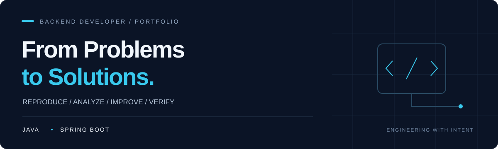

  

# WonJiSun0730 · Backend Developer

**문제를 재현하고, 원인을 분석하며, 검증 가능한 개선을 지향합니다.**

Java와 Spring Boot를 중심으로 백엔드 개발에 집중하고 있습니다.  
QA에서 문제를 발견하고 검증하던 관점을 개발로 이어가고자 합니다.  
기능 구현뿐 아니라 **왜 문제가 발생했는지, 변경 후 무엇으로 검증할지**를 함께 설명하는 개발자를 지향합니다.

## 01 / Core Focus

**Java · Spring Boot · Spring Data JPA · Spring Security**  
**함께 사용하는 기술** — React · Vite · Redis · Python / FastAPI

- **문제 해결** — 재현 조건과 로그를 확인하고, 원인 분석부터 회귀 검증까지 연결합니다.
- **백엔드 개발** — LLM 응답 스트리밍·QA 계측, Spring–Python 서비스 연동, Redis 대화 문맥 관리를 구현한 기록이 있습니다.
### QA Experience | Quality Assurance

**컴투스 FISHING-QA**  
2022.11 – 2026.05 · 게임 QA 서브리더

**그린맨파워 (넥슨 파견)**  
2018.03 – 2020.03 · 개발 QA

**Tools & Experience**
- **Google Sheets** — 테스트 케이스(TC) 관리 및 테스트 수행
- **MantisBT** — 결함 등록 및 이슈 추적
- **TestFlight** — iOS 테스트 빌드 검증
- **Build Handoff** — QA 완료 빌드의 최종 검증 및 납품 담당자 인계

**주요 업무 및 경험**
- 테스트 케이스 기반 기능 검증 및 결함 관리
- 테스트 자동화 스크립트 제작을 통한 반복 업무 개선
- 스프레드시트 함수를 활용한 기획 데이터 및 계산 로직 검증
- QA 완료 빌드의 검증 결과 확인 및 납품 프로세스 참여

QA 경험을 통해 문제 재현, 원인 분석, 검증 자동화 역량을 쌓았으며, 이를 바탕으로 안정성과 유지보수성을 고려하는 백엔드 개발을 지향합니다.

<!-- 두 프로젝트의 pom.xml에 MySQL 드라이버 의존성이 있습니다.
실제 운영 DB와 본인의 DB 설계 범위는 별도 확인 후 추가합니다. -->

## 02 / Featured Projects

### 01 — PocketMM

**세계관·캐릭터 기반 AI 대화와 서사 진행을 지원하는 플랫폼**

| 항목 | 내용 |
| :--- | :--- |
| 주요 기능 | LLM 대화 생성, 대화 기억 관리, QA 비용·처리 시간 계측 |
| 확인된 기여 | 응답 본문 스트리밍과 첫 본문 수신 시간 계측 구현 |
| 프로젝트 기술 | Java · Spring Boot · Spring Data JPA · Spring Security · React · Vite |
| 문제 해결 사례 | QA 중 미전송 생성 요청을 사용량 유실로 분류하던 문제를 분석하고, 미전송 상태와 실제 과금 미확인을 구분하도록 개선한 기록 |
| 개발 형태 · 기간 | [확인 필요: 개인/팀, 개발 기간, 현재 상태] |

[Repository](https://github.com/WonJiSun0730/PocketMM) · [스트리밍 구현 커밋](https://github.com/WonJiSun0730/PocketMM/commit/f0f5d7fe22adfd28ccb4e9cede46228785abb8f0) · [QA 조사 기록](https://github.com/WonJiSun0730/PocketMM/blob/main/docs/qa-57turn-audit.md)

기술적 의사결정과 검증 근거

**응답 스트리밍과 처리 단계 계측**

- 구조화된 LLM 응답에서 본문 문자열을 추출해 단계적으로 전달합니다.
- 첫 본문 수신, 전체 본문 수신, 후처리 완료를 구분해 계측합니다.
- 연결 중단 시 유료 요청을 자동 재전송하지 않고 저장·사용량 상태를 구분합니다.
- 분할 수신, 한국어·이스케이프 처리, 중단 시 사용량 보호에 대한 테스트와 검증 기록이 있습니다.
- 실제 서비스의 지연 감소율이나 비용 절감률은 이 구현만으로 단정하지 않습니다.

[구현·검증 문서](https://github.com/WonJiSun0730/PocketMM/blob/main/docs/pocket-token-streaming.md)

**대화 기억 관리**

사용자 발언의 원문 근거와 구조화된 정보를 함께 보존하고, 회상 시 방·캐릭터 범위와 출처를 구분하는 설계가 문서화되어 있습니다.

[기억 관리 설계](https://github.com/WonJiSun0730/PocketMM/blob/main/docs/structured-memory.md)

### 02 — BloodOps

**헌혈 예약·혈액 관리 및 헌혈 안내를 제공하는 통합 서비스**

| 항목 | 내용 |
| :--- | :--- |
| 서비스 전체 범위 | 헌혈 예약 조회·생성·변경·취소, 혈액 관리, 헌혈 안내 챗봇 |
| 확인된 기여 | Spring–FastAPI 내부 통신 연동, Redis 기반 챗봇 대화 문맥 관리 |
| 기여 기술 | Java · Spring Boot · Python · FastAPI · Redis |
| 프로젝트 기술 | Spring Data JPA · Spring Security · React · Vite |
| 설계 포인트 | Redis Hash에 직전 의도·검색어를 저장하고 TTL을 갱신하며, Redis 장애 시 문맥 없이 질문 처리를 이어가도록 예외 처리 |
| 팀 구성 · 기간 | [확인 필요: 팀 인원, 개발 기간, 현재 상태] |

[Repository](https://github.com/WonJiSun0730/BloodOps) · [AI·Redis 연동 PR #69](https://github.com/WonJiSun0730/BloodOps/pull/69) · [문맥 관리 구현 커밋](https://github.com/WonJiSun0730/BloodOps/commit/7c5258e0ebd81586efe227694c8c5c3ec6f65203)

담당 기능과 설계 판단

- **서비스 연동:** Spring 백엔드와 FastAPI 기반 의도 분류·지식 검색 서비스를 연결합니다.
- **문맥 유지:** 대화 식별자별로 직전 의도·검색어를 저장하고, 대화가 이어지면 만료 시간을 갱신합니다.
- **장애 처리:** Redis 조회·저장 실패를 처리해 문맥 저장소 오류가 질문 처리 전체의 장애로 이어지는 것을 줄이도록 설계했습니다.
- **기여 근거:** 위 PR과 커밋의 작성 계정 및 변경 코드를 확인했습니다. 서비스 전체 기능이 모두 본인 담당이라는 뜻은 아닙니다.
- **추가 확인:** [확인 필요: 리뷰·인터페이스 조율 등 협업 사례와 추가 담당 범위]

[문맥 저장·예외 처리 코드](https://github.com/WonJiSun0730/BloodOps/blob/develop/src/main/java/com/shop/chatbot/service/AiConversationMemoryService.java)

> 두 프로젝트 저장소는 현재 비공개입니다. 코드·PR·문서 링크는 저장소 접근 권한이 있는 경우 열람할 수 있습니다.

## 03 / QA → Development

**대표 사례 — PocketMM QA의 미전송·과금 미확인 분류 개선**

| 단계 | 확인된 프로젝트 기록 |
| :--- | :--- |
| 재현 | 보조 호출 비용이 발생한 뒤, 생성 요청 전 입력 토큰 계수 단계에서 통신 오류가 발생하는 조건을 모의 HTTP로 재현 |
| 분석 | 생성 요청이 전송되지 않았는데도 대상 사용량이 없다는 이유로 가상의 비용 미확인 항목을 만드는 분류 문제 확인 |
| 개선 | 미전송 요청은 별도로 기록하고, 이미 발생한 보조 호출 비용과 실제 전송 후 사용량 미확인을 구분 |
| 검증 | 생성 미전송·보조 비용 보존·자동 재시도 방지와 완료 턴 보존에 대한 회귀 검증 기록 |

단순히 실행이 멈춘 현상을 비용 부족으로 판단하지 않고, **전송 여부와 비용 기록을 분리해 원인을 좁힌 사례**입니다. 구현 이후에도 실제 사용량을 받지 못한 요청은 과금 미확인으로 남기는 보호 정책을 유지했습니다.

[상세 조사·검증 기록](https://github.com/WonJiSun0730/PocketMM/blob/main/docs/qa-57turn-audit.md)

<!-- 테스트 통과 내용은 저장소 문서에 기록된 결과입니다.
프로필 작성 과정에서 재실행한 결과가 아니며, 추정 절감률·모의 지연을 실서비스 성과로 표시하지 않습니다. -->

## 04 / Contact

- **GitHub:** [WonJiSun0730](https://github.com/WonJiSun0730)
- **Email:** [확인 필요: 공개할 이메일]
- **Resume / Portfolio:** [확인 필요: 공개 가능한 링크]
